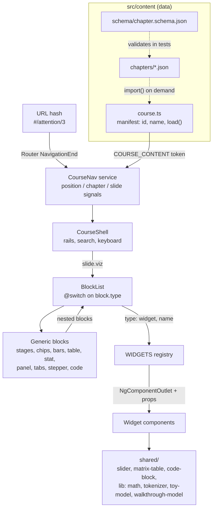

# Architecture

How **AI, Unboxed** is built, and why. For day-to-day coding rules, see [CLAUDE.md](CLAUDE.md).

## In one paragraph

The site is a static Angular 21 single-page app. It has no zone.js and no backend. All course text and layout live in JSON chapter files. One Angular component, the **course shell**, reads the URL (`#/chapterId/slide`), finds the matching slide in the content, and renders it.

A slide has two columns:

- **Prose** on the left: paragraphs, lists, notes.
- A **viz** on the right: a list of blocks.

Blocks come in two kinds. **Generic blocks** (stages, chips, tabs, stepper, etc.) are driven entirely by config. **Widgets** are named Angular components, for interactions that compute something. The build is published to GitHub Pages by a GitHub Actions workflow, and it only deploys if every chapter validates and every slide renders.

## Layers

| Layer       | Folder                           | Responsibility                                                                                                                           | Must not                                                                                     |
| ----------- | -------------------------------- | ---------------------------------------------------------------------------------------------------------------------------------------- | -------------------------------------------------------------------------------------------- |
| Content     | `src/content/`                   | Words, ordering, layout. Plain JSON validated by a schema.                                                                               | Contain logic. Raw HTML is allowed only in the `html`/prose strings that the schema permits. |
| Course core | `src/app/course/`                | Content types (`content.model.ts`), URL ⇄ position mapping (`course-position.ts`, pure), navigation state (`course-nav.ts`), page shell. | Know about any specific chapter or widget.                                                   |
| Blocks      | `src/app/blocks/`                | Generic renderers, one for each `Block` type. `BlockList` dispatches and nests.                                                          | Hold chapter-specific behaviour.                                                             |
| Widgets     | `src/app/widgets/`               | Interactive explainers with real logic, grouped by chapter (`<topic>.widgets.ts`), registered by name in `registry.ts`.                  | Reach into navigation or global state, except a widget that renders `goto` links.            |
| Shared      | `src/app/shared/`                | Reusable UI primitives (slider, matrix table, code block, theme) and pure helpers in `lib/`.                                             | Import from `course/`, `blocks/` or `widgets/`.                                              |
| Styles      | `src/styles.css` + component CSS | Global holds tokens, reset, shared primitives and `[innerHTML]` styles. Everything else is component-scoped.                             | Put one-component styles in the global file.                                                 |

Dependencies point **downward only**: content → course → blocks → widgets → shared. `shared/` depends on nothing in the app.

## Key decisions

### 1. Content is data, behaviour is code

Every slide is JSON (`ChapterContent → SlideContent → Prose[] + Block[]`). Adding a chapter means adding a file plus one manifest entry (id, name, loader) in `course.ts`, with no Angular code. A new interaction becomes a widget only when a generic block can't express it.

`chapter.schema.json` gives editors autocomplete. The same schema runs in `course.spec.ts` through ajv, so a malformed chapter fails CI before deploy.

### 2. The URL is the single source of truth

`CourseNav` turns `Router` events into a `url` signal with `toSignal`. All other state is `computed` from it: position, chapter, section, slide, isFirst/isLast, nextLabel.

Navigation only ever calls `router.navigate`, and no component stores "current slide" itself. Two things follow from this:

- Back/forward, deep links and reloads all work without extra code.
- The position logic in `course-position.ts` is pure functions, unit-tested with no TestBed.

**Hash routing** (`withHashLocation`) lets the build run on any static host (Pages, S3, Netlify) with no rewrite rules. The route `:chapter/:slide` renders `CourseShell` after `chapterResolver` has loaded that chapter; `:chapter` alone redirects to slide 1 (old `#assistant` links), and anything unknown redirects to the first chapter.

### 3. A registry decouples JSON from components

JSON refers to a widget by string name (`{ "type": "widget", "name": "temperature" }`). `WIDGETS` in `registry.ts` maps names to lazy loaders (`() => import(...)`), so each widget file is its own chunk. `WidgetHost` renders the loaded component with `NgComponentOutlet`, passing `props` through `inputs`; the chapter resolver preloads a chapter's widgets so they appear without a placeholder. Two tests keep this honest:

- every widget name used in content must be registered;
- the schema's widget `enum` must match the registry keys.

### 4. Signals everywhere, zoneless

The app has no zone.js; Angular 21 is zoneless by default. Change detection runs only when a template-read signal changes, an input is set, or a bound event fires.

Every component therefore uses `OnPush` and keeps template state in signals:

- `signal` for local state;
- `computed` for derived state;
- `linkedSignal` for state that resets when an input changes (for example `Tabs.active` follows `selected`);
- `model` for two-way bindings (for example `Slider.value`).

### 5. Recursive blocks

`panel`, `tabs` and `stepper` contain `Block[]`, so they render `<app-blocks [nested]="true">` again. `forwardRef(() => BlockList)` breaks the import cycle. At top level, each visual block gets its own `.panel`. When nested, blocks stack bare.

### 6. Theming via tokens

`styles.css` defines colour tokens for the light palette on `:root` and overrides them for dark, both under `prefers-color-scheme` and under `[data-theme="dark"]`.

- **Theme switching:** the `Theme` service (`shared/theme`) stores `auto | light | dark` in `localStorage` (`ai-unboxed:theme`) and sets `data-theme` on `<html>`. An inline script in `index.html` applies the same choice before first paint, so the page never flashes the wrong theme.
- **Text colours:** text uses the `*-ink` tokens (`--accent-ink`, `--pos-ink`, …), which pass WCAG AA. The bare tokens (`--accent`, `--pos`, …) are for fills and strokes. `blocks/tone.ts` maps content `tone` values to ink tokens.

### 7. Cross-chapter links by id

Slides link to other chapters with `goto: { chapter: "<id>", slide: n }` and refer to them by name in prose, never by number. Chapters can therefore be reordered or inserted without breaking links.

## Request → render walkthrough

1. A user opens `https://sgarg5858.github.io/ai-unboxed/#/attention/3`.
2. The Router emits `NavigationEnd`, and the `CourseNav.url` signal updates.
3. `resolvePosition(COURSE, '/attention/3')` returns `{ chapter: 3, slide: 2 }`, clamping bad ids or numbers.
4. `CourseShell` renders:
   - the section tabs (`course/section-tabs`) and the course outline (`course/course-outline`): on wide screens a sidebar with the current section's chapters, each expandable to its slides, toggled by its panel button (`course/sidebar-toggle`) and remembered in `localStorage` (`SidebarState`); on narrower ones a `<dialog>` drawer (`course/contents-drawer`) with every section, opened by the same panel icon in the header;
   - the slide itself through `SlideView` (`course/slide-view`): prose, `<app-blocks [blocks]="slide.viz">` and figures;
   - the command palette (`course/command-palette`): a `<dialog>` combobox that searches every loaded slide (`searchSlides` in `course/course-search.ts`), opened with `/`, Ctrl/⌘+K or the header's search field. `ReadingProgress` keeps the slides the reader has ticked as done (the circles in the outline) in `localStorage` (`ai-unboxed:read`), synced across tabs, so the outline and palette can show them.
5. `BlockList` switches on each block's `type`. For a widget, it looks up `WIDGETS[name]` and renders it through `NgComponentOutlet` with `props`.
6. ←/→ keys or the Back/Next buttons call `nav.step(±1)`, which navigates, and the cycle repeats.

## Build, test, deploy

- **Build:** `@angular/build:application` (esbuild). Output goes to `dist/ai-unboxed/browser`.
- **Budgets:** initial bundle warns at 500 kB and errors at 1 MB. Each component stylesheet warns at 4 kB and errors at 8 kB.
- **Lazy loading:** the initial bundle holds only the app shell and the course manifest (about 290 kB raw, 80 kB transferred). Each chapter's JSON and each widget file is a separate chunk, fetched when its route is opened (`ChapterStore.load`). After the first render, the remaining chapters prefetch in the background, so moving between chapters stays instant and the outline can show every chapter's slide count.
- **Tests:** Vitest through `@angular/build:unit-test`, with jsdom. There are three kinds:
  - pure-function tests (`course-position`, `highlight`, `theme`);
  - a content test that validates the schema, registry and section integrity (`course.spec.ts`);
  - a shell test that renders **every slide** of every chapter and fails on any error (`course-shell.spec.ts`).
- **Deploy:** `.github/workflows/deploy-pages.yml` runs on every push to `main`. It does `npm ci`, then `npm test -- --watch=false`, then `ng build --base-href "/<repo-name>/"`, then publishes to Pages. Because the base href comes from the repo name, renaming the repo can't break asset paths.

## Extending

| Want to…                       | Do this                                                                                                                                                                                               |
| ------------------------------ | ----------------------------------------------------------------------------------------------------------------------------------------------------------------------------------------------------- |
| Add a chapter                  | Copy a file in `src/content/chapters/`, keep the `$schema` line, and add `{ id, name, load }` for it to a section in `course.ts`.                                                                     |
| Add a section (RAG, Agents, …) | Add `{ id, name, chapters }` to `SECTIONS` in `course.ts`. The rail picks it up automatically.                                                                                                        |
| Add a widget                   | Write the component in `widgets/<topic>.widgets.ts`, register a lazy loader for it in `registry.ts`, and add its name to the widget `enum` in `chapter.schema.json`. Tests fail if you forget either. |
| Add a generic block type       | Add it to the `Block` union in `content.model.ts`, add a renderer in `blocks/`, add a `@case` in `BlockList`, and add it to the schema.                                                               |
| Add a diagram or image         | Put light and dark files in `public/images/` and add `figure` to the slide. It renders full width under both columns (`shared/slide-figure`).                                                         |
| Add a colour                   | Add the token to both the light and dark blocks in `styles.css`. Add an `-ink` variant if it will colour text.                                                                                        |
